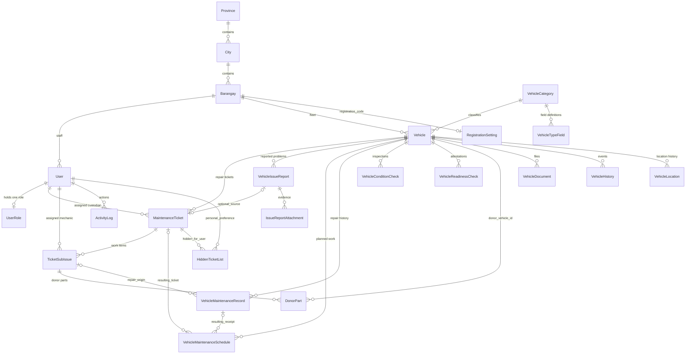

# ERD working source

Baseline: 28 October 2026, working tree on `dev-paul` after `20449a7`. This is a logical relationship overview derived from Eloquent models, not an exhaustive physical database diagram. The physical schema is MySQL 8 `barangay_vms_db` (47 tables, 74 foreign keys); the [ERD](../VMS%20FINAL%20DEFENSE%20PREPARATION/ERD.svg) and [Schema-Reference.md](../VMS%20FINAL%20DEFENSE%20PREPARATION/Schema-Reference.md) in the defense folder are generated from it. Use migration definitions for enforced keys, nullable relations, unique constraints and cascade rules.

## Data dictionary and modeling decisions

| Area | Keys / relationship notes |
|---|---|
| Tenant and geography | Province ? City ? Barangay. Operational models use barangay scoping, directly or through Vehicle. Platform accounts may have no barangay. Global catalogs must not be drawn as tenant-owned without a schema change. |
| Vehicle | PK vehicle_id; category_id references VehicleCategory. Availability, condition and readiness evidence are distinct. current_location is a location value; do not invent a Vehicle-to-Hub FK from a label match. |
| Tickets | PK ticket_id; vehicle_id, issue_report_id and user assignments. TicketSubIssue uses sub_issue_id and ticket_id. Optional sources do not mean every ticket has an issue report. |
| Records and schedules | Record PK maintenance_id; schedule PK schedule_id. ticket_sub_issue_id, resulting_ticket_id and resulting_maintenance_id describe provenance; scheduled repair source takes precedence in reporting. |
| Evidence and audit | Documents and issue attachments belong to parent records; ManagedFile tracks private storage references. Do not draw a universal FK from free-text file references. Histories/audit links can be logical references rather than database FKs. |
| Personal hidden list | Physical table hidden_ticket_lists links user_id and ticket_id with foreign keys and a per-pair uniqueness rule. It is not a repair archive or a ticket state. |
| Roles | `users.role` is the primary role used for routing; `user_roles` (user_id, role) holds the account's role, **at most one row** (the earlier `users.roles` JSON column was removed). Permissions are config-driven (`config/permissions.php`), so there is no Role or Permission table. `users.barangay_name` was removed; the barangay is read through `barangay_id`. |
| Accounts and security | `users.must_change_password` marks an Admin-created account whose temporary password must be replaced; `registration_id_path` and `registration_photo_path` reference private files uploaded at registration; `awaiting_staff_code` and `staff_code_sent_at` support first-Admin activation. |
| Donor parts | `ticket_sub_issue_donor_parts` (PK part_id) has `sub_issue_id` and, since 28 October, `donor_vehicle_id` (nullable FK to `vehicles`, null on delete) so one repair can take parts from several donor vehicles. `ticket_sub_issues.source_vehicle_id` remains the first donor. |

Supporting entities omitted from the core SVG include VehicleImport, CannibalizationRecord/CannibalizationPart, TicketArchiveLog, FaultCategory, MaintenanceType, ExternalReason, RecurrenceInterval, ManagedFile, Notification, ConcernReport and ReportedPerson. Keep them in a detailed physical ERD when that view is needed. Laravel token/infrastructure tables are separate from the domain overview.

Sources: [models](../backend-api/app/Models), [migrations](../backend-api/database/migrations), [requirements mapping](Requirements-Traceability.md). Cardinality lines describe possible stored associations; workflow requirements such as at least one proposed work item are application rules.
