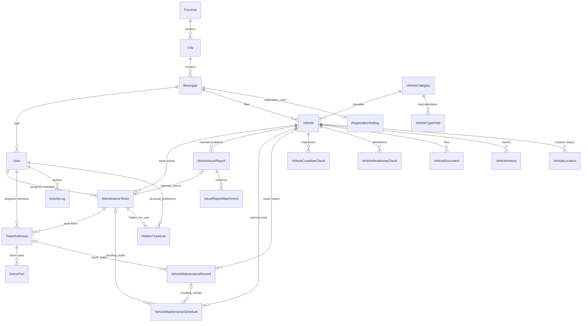

# ERD working source

Baseline: 25 October 2026, `130fe38`. This is a logical relationship overview derived from Eloquent models, not an exhaustive physical database diagram. The [SVG](ERD.svg) is a core-module summary. Use migration definitions for enforced keys, nullable relations, unique constraints and cascade rules.

## Data dictionary and modeling decisions

| Area | Keys / relationship notes |
|---|---|
| Tenant and geography | Province ? City ? Barangay. Operational models use barangay scoping, directly or through Vehicle. Platform accounts may have no barangay. Global catalogs must not be drawn as tenant-owned without a schema change. |
| Vehicle | PK vehicle_id; category_id references VehicleCategory. Availability, condition and readiness evidence are distinct. current_location is a location value; do not invent a Vehicle-to-Hub FK from a label match. |
| Tickets | PK ticket_id; vehicle_id, issue_report_id and user assignments. TicketSubIssue uses sub_issue_id and ticket_id. Optional sources do not mean every ticket has an issue report. |
| Records and schedules | Record PK maintenance_id; schedule PK schedule_id. ticket_sub_issue_id, resulting_ticket_id and resulting_maintenance_id describe provenance; scheduled repair source takes precedence in reporting. |
| Evidence and audit | Documents and issue attachments belong to parent records; ManagedFile tracks private storage references. Do not draw a universal FK from free-text file references. Histories/audit links can be logical references rather than database FKs. |
| Personal hidden list | Physical table hidden_ticket_lists links user_id and ticket_id with foreign keys and a per-pair uniqueness rule. It is not a repair archive or a ticket state. |
| Roles | User stores primary role and multi-role data; no separate Role/UserRole tables should be invented. |

Supporting entities omitted from the core SVG include VehicleImport, CannibalizationRecord/CannibalizationPart, TicketArchiveLog, FaultCategory, MaintenanceType, ManagedFile, Notification, ConcernReport and ReportedPerson. Keep them in a detailed physical ERD when that view is needed. Laravel token/infrastructure tables are separate from the domain overview.

Sources: [models](../backend-api/app/Models), [migrations](../backend-api/database/migrations), [requirements mapping](Requirements-Traceability.md). Cardinality lines describe possible stored associations; workflow requirements such as at least one proposed work item are application rules.
