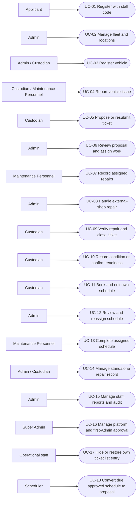

# Use-case working source

Baseline: 25 October 2026, `130fe38`. The [SVG](Use-Case-Diagram.svg) groups current use cases by actor. This Mermaid view is an editable actor/action overview, not formal UML include/extend notation. Shared actors do not inherit every action from each other.

Use [the traceability table](Requirements-Traceability.md) for preconditions, entity links and role restrictions. Actor groups such as Admin / Custodian apply only to the named action. UC-14 deliberately summarizes a three-step standalone record lifecycle; Admin entry/confirmation and Custodian verification remain separate responsibilities.

## Diagram rules

- Keep the platform boundary separate from barangay fleet access. Super Admin has no ordinary fleet access.
- Model successful ticket closure as the outcome of assigned independent Custodian verification, not a second Admin approval use case.
- Model scheduled conversion as a scheduler action creating a proposal, not automatic approval.
- Do not infer include/extend from chronological order. For a formal UML export, split UC-14 into enter, independently verify and confirm, then assign each to its actor.
- A utility impersonation account is an optional support actor, not a Super Admin permission. Its local/testing write exceptions and production expiry/read-only guards belong in support documentation.
- Public concern submission and optional support switching can be expanded in a separate platform/support diagram. They do not grant fleet permissions.

Authority: [permission grants](../backend-api/config/permissions.php), controller state/ownership checks, [Must-Haves](Must-Haves.md). Authorization findings and deployment acceptance remain tracked in [revision notes](Current-Revision-2026-10-25.md).
